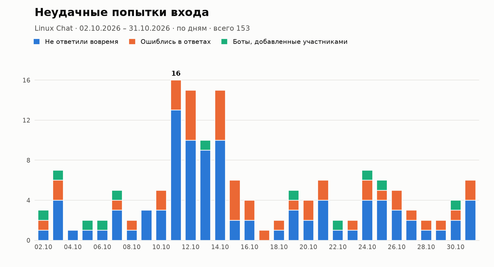

# axbot

[Русская версия](README.md)

A Telegram bot that keeps spam bots out of group chats. Every new member has to answer a simple question. No special knowledge is needed, just careful reading and basic logic.

Note: the bot's messages and questions are in Russian.

## What it does

When someone joins the chat, the bot mutes them and posts a question with buttons. There are two kinds of questions. Some have one correct button, for example "A train left at 9:45 and traveled for 50 minutes. When did it arrive?". Others need several buttons pressed in the right order, for example sorting fruit names alphabetically.

If the answer is right, the bot unmutes the user and greets them. A wrong answer gives them a different question until they run out of attempts. When the attempts run out or time is up, the bot removes the user from the chat. You can choose between a kick (they can join again) and a ban.

The bot also:

- doesn't let anyone press buttons on someone else's captcha;
- kicks bots added by regular members and skips the check for anyone added by an admin;
- deletes "joined the group" and "left the group" messages if that is enabled;
- removes the captcha if the user leaves without answering;
- keeps everything in SQLite, so pending checks and timers survive a restart.

## Question themes

There are two themes right now, and the chat admin picks one in the settings.

Universal works for any chat and is the default. It has puzzles about counting, time, days of the week and simple logical conclusions.

Linux is for Linux chats. Same kind of logic, but with jokes about vim, sudo and Tux the penguin. You still don't need to know anything about Linux to answer.

The theme decides the questions, the captcha text, the default greeting and the message shown when someone fails.

If you need another theme, say for a gaming, programming or local community chat, [open an issue](https://github.com/Axawys/axbot/issues) describing it and I'll add it to the bot.

## Statistics

The bot keeps track of who was shown a captcha and how it ended. The owner and managers can request statistics for their chat over any period up to a year: the bot sends a chart of failed join attempts with a summary below it.



The chart shows how many people didn't answer in time, how many answered wrong, and how many bots were added by regular members. The summary also lists how many people were shown the captcha, how many passed and what percentage that is, how many were let in manually, and how many left without answering. Periods longer than 92 days are grouped by week on the chart.

In the group, use the `/stats` command. In private chat, open the chat's settings and go to "Статистика" (Statistics). The period can be given as:

- nothing: the last 7 days;
- `30`: the last 30 days;
- `01.10.2026 31.10.2026` or `2026-10-01 2026-10-31`: from one date to another;
- `15.10`: a single day of the current year.

Days are counted in the time zone set in `TIMEZONE`.

To render an example chart from made-up data, run `python scripts/stats_example.py example.png 30`.

## Who can manage the bot

The owner, which is whoever added the bot to the chat. If the bot is removed and added again, the owner only changes if the person who re-added it is a chat admin.

The chat creator can always manage the bot.

Managers, appointed by the owner.

Superadmins listed in `SUPERADMINS`. They can see and configure every chat.

## Settings in private chat

Send `/start` to the bot and open "Мои чаты" (My chats). For each chat you can turn the captcha on or off, set the time limit, the number of attempts, what happens to users who fail, the theme and the question type. The same panel has the statistics, the greeting text and its auto-delete timer, deletion of service messages, and the list of managers. The "Попробовать капчу" (Try the captcha) button sends you a test question.

## Commands in the group

Only the owner and managers can use these. If anyone else sends one, the bot just deletes it. The bot deletes the command and its reply after a minute to keep the chat clean.

| Command | What it does |
|---|---|
| `/settings` | shows the settings and a link to the private panel |
| `/help` | list of commands |
| `/captcha on` or `off` | turns the captcha on or off |
| `/timeout 120` | time to answer in seconds, 30 to 3600 |
| `/attempts 2` | number of attempts, 1 to 5 |
| `/action kick` or `ban` | kick or ban users who fail |
| `/theme universal` or `linux` | question theme. Without an argument it shows the current one and the list of available themes |
| `/mode mixed`, `choice` or `order` | mixed questions, single-choice only, or order only |
| `/greeting text` | custom greeting. You can also reply to a message with the command. `/greeting reset` restores the default |
| `/greetttl 300` | delete the greeting after this many seconds, 0 means keep it |
| `/clean on` or `off` | delete join and leave messages |
| `/pass` | let a user in without the captcha. Reply to their captcha or message, or pass their ID |
| `/stats` | chart of failed join attempts. You can give a period: `/stats 30` or `/stats 01.10.2026 31.10.2026` |
| `/managers` | who manages the bot |
| `/addmanager`, `/delmanager` | add or remove a manager by replying to their message or by ID. Owner only |

The greeting text supports `{mention}` (a link to the user), `{name}` (their name) and `{chat}` (the chat title). HTML formatting works too.

## Running

Create a bot with [@BotFather](https://t.me/BotFather) and copy the token. Copy `.env.example` to `.env` and put the token in `BOT_TOKEN`. Set `TIMEZONE` to the chat's time zone, for example `Europe/Moscow`, otherwise statistics are counted in UTC.

With Docker:

```sh
docker compose up -d --build
```

Without Docker, Python 3.11 or newer:

```sh
python -m venv .venv
.venv/bin/pip install -r requirements.txt
.venv/bin/python -m axbot
```

Then add the bot to your group and make it an admin with the "Ban users" and "Delete messages" permissions. Telegram doesn't tell bots about new members unless they are admins, so the captcha won't work without this.

## Development

```sh
.venv/bin/pip install -e '.[dev]'
.venv/bin/pytest
```

Each theme lives in its own file in [`axbot/questions/`](axbot/questions/). To add one, create a file there modeled on `universal.py` and register it in `axbot/questions/__init__.py`. Every question must contain everything needed to answer it.

## License

[0BSD](LICENSE). You can copy, modify and use the code however you like, including in closed-source and commercial projects, with no need to credit the author.
