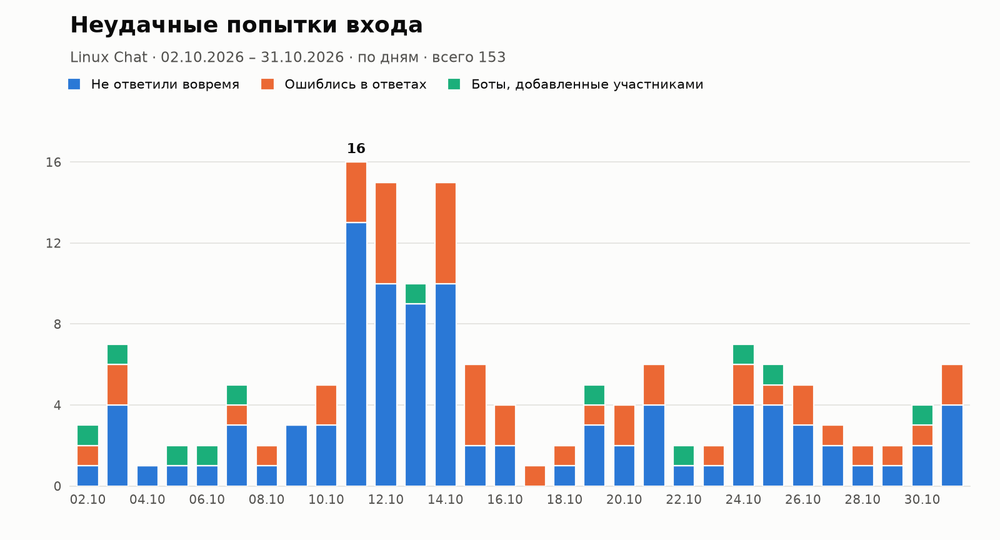

# axbot

[English version](README.en.md)

Бот для Telegram-групп, который не пускает в чат спам-ботов. Каждый новый участник должен ответить на простой вопрос. Знать для этого ничего не нужно, хватит внимательности и элементарной логики.

## Что делает бот

Когда в чат заходит новый человек, бот запрещает ему писать и присылает вопрос с кнопками. Вопросы бывают двух видов. В одних нужно нажать одну правильную кнопку, например «Поезд отправился в 9:45 и ехал 50 минут. Во сколько он прибыл?». В других нужно нажать несколько кнопок в правильном порядке, например расставить фрукты по алфавиту.

Если человек ответил правильно, бот снимает ограничения и приветствует его. Если ошибся, получает другой вопрос, пока не кончатся попытки. Если попытки кончились или время вышло, бот удаляет его из чата. Можно выбрать, просто выгнать (тогда можно зайти снова) или забанить.

Ещё бот:

- не даёт нажимать на кнопки чужой капчи;
- выгоняет ботов, которых добавил обычный участник, и не проверяет тех, кого добавил администратор;
- удаляет сообщения «вступил в группу» и «покинул группу», если это включено в настройках;
- убирает капчу, если человек вышел из чата, не ответив;
- хранит всё в SQLite, поэтому после перезапуска незавершённые проверки и таймеры никуда не деваются.

## Тематики вопросов

Сейчас их две, администратор чата выбирает нужную в настройках.

Универсальная подходит для любого чата и стоит по умолчанию. Это задачки на счёт, время, дни недели и простые логические выводы.

Linux для чатов о Linux. Логика та же, но с шутками про vim, sudo и пингвина Tux. Разбираться в Linux для ответа всё равно не нужно.

От тематики зависят вопросы, текст капчи, стандартное приветствие и сообщение о том, что человек не прошёл проверку.

Если нужна другая тематика, например для чата об играх, программировании или о вашем городе, [создайте issue](https://github.com/Axawys/axbot/issues) с описанием, и я добавлю её в бота.

## Статистика

Бот запоминает, кому показал капчу и чем всё закончилось. Владелец и менеджеры могут запросить статистику по своему чату за любой период до года: бот пришлёт график неудачных попыток входа и сводку под ним.



На графике видно, сколько людей не ответили вовремя, сколько ошиблись и сколько ботов добавили обычные участники. В сводке ещё указано, скольким показали капчу, сколько её прошли и какой это процент, сколько пропущено вручную и сколько ушли сами, не ответив. Периоды длиннее 92 дней на графике группируются по неделям.

В чате статистику показывает команда `/stats`, в личке с ботом раздел «Статистика» в настройках чата. Период задаётся так:

- без параметров: последние 7 дней;
- `30`: последние 30 дней;
- `01.10.2026 31.10.2026` или `2026-10-01 2026-10-31`: с даты по дату;
- `15.10`: один день текущего года.

Дни считаются по часовому поясу из переменной `TIMEZONE`.

Пример графика на выдуманных данных можно построить командой `python scripts/stats_example.py пример.png 30`.

## Кто может настраивать бота

Владелец, то есть тот, кто добавил бота в чат. Если бота удалят и добавят снова, владелец поменяется, только если бота добавил администратор чата.

Создатель чата может управлять ботом всегда.

Менеджеры. Их назначает владелец.

Суперадмины из переменной `SUPERADMINS`. Они видят и настраивают все чаты.

## Настройка в личке с ботом

Напишите боту `/start` и откройте «Мои чаты». Для каждого чата можно включить или выключить капчу, выбрать время на ответ, количество попыток, что делать с теми, кто не прошёл проверку, тематику и тип вопросов. Там же можно посмотреть статистику, настроить приветствие и его автоудаление, удаление сервисных сообщений и список менеджеров. Кнопка «Попробовать капчу» присылает тестовый вопрос.

## Команды в чате

Команды работают только у владельца и менеджеров. Если команду отправит кто-то другой, бот просто её удалит. Команду и ответ на неё бот удаляет через минуту, чтобы не засорять чат.

| Команда | Что делает |
|---|---|
| `/settings` | показывает настройки и ссылку на панель в личке |
| `/help` | список команд |
| `/captcha on` или `off` | включает или выключает капчу |
| `/timeout 120` | время на ответ в секундах, от 30 до 3600 |
| `/attempts 2` | количество попыток, от 1 до 5 |
| `/action kick` или `ban` | выгнать или забанить того, кто не прошёл проверку |
| `/theme universal` или `linux` | тематика вопросов. Без аргумента показывает текущую и список доступных |
| `/mode mixed`, `choice` или `order` | вопросы вперемешку, только с выбором ответа или только на порядок |
| `/greeting текст` | своё приветствие. Можно ответить командой на сообщение с текстом. `/greeting reset` возвращает стандартное |
| `/greetttl 300` | удалять приветствие через указанное число секунд, 0 значит не удалять |
| `/clean on` или `off` | удалять сообщения о входе и выходе |
| `/pass` | пропустить человека без капчи. Ответьте командой на его капчу или сообщение либо укажите ID |
| `/stats` | график неудачных попыток входа. Можно указать период: `/stats 30` или `/stats 01.10.2026 31.10.2026` |
| `/managers` | кто управляет ботом |
| `/addmanager`, `/delmanager` | добавить или убрать менеджера, ответом на сообщение или по ID. Только для владельца |

В тексте приветствия можно использовать `{mention}` (ссылка на пользователя), `{name}` (имя) и `{chat}` (название чата). HTML-разметка тоже работает.

## Запуск

Создайте бота через [@BotFather](https://t.me/BotFather) и скопируйте токен. Затем скопируйте `.env.example` в `.env` и впишите токен в `BOT_TOKEN`. В `TIMEZONE` укажите часовой пояс чата, например `Europe/Moscow`, иначе статистика будет считаться по UTC.

Через Docker:

```sh
docker compose up -d --build
```

Без Docker, нужен Python 3.11 или новее:

```sh
python -m venv .venv
.venv/bin/pip install -r requirements.txt
.venv/bin/python -m axbot
```

После этого добавьте бота в группу и сделайте администратором с правами «Блокировка пользователей» и «Удаление сообщений». Без прав администратора Telegram не сообщает боту о новых участниках, и капча работать не будет.

## Разработка

```sh
.venv/bin/pip install -e '.[dev]'
.venv/bin/pytest
```

Каждая тематика лежит в отдельном файле в [`axbot/questions/`](axbot/questions/). Чтобы добавить новую, создайте там файл по образцу `universal.py` и подключите его в `axbot/questions/__init__.py`. Для ответа на любой вопрос должно хватать информации из самого вопроса.

## Лицензия

[0BSD](LICENSE). Код можно копировать, менять и использовать как угодно, в том числе в закрытых и коммерческих проектах, без указания автора.
